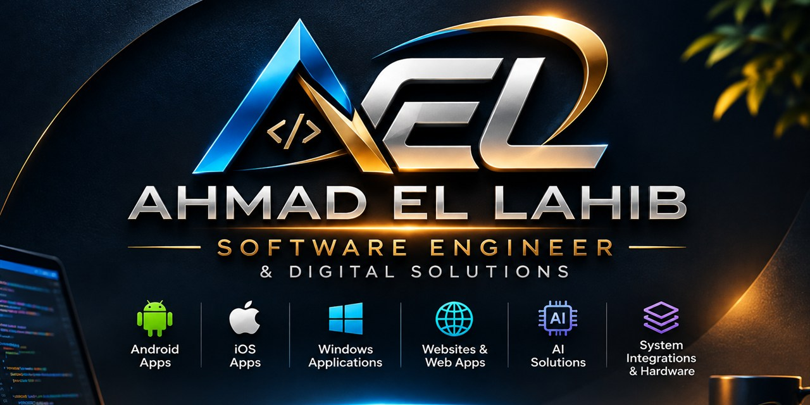

## Hi there 👋

**Senior Android Developer at areeba · Payment terminals, EMV & POS apps · AI-assisted development · Freelance Android, Windows & web apps in Lebanon** — [ahmadellahib.dev](https://ahmadellahib.dev)

I'm an **Android developer working on payment terminals** at [areeba](https://www.areeba.com) — the apps that run on POS devices, read cards, talk to cash registers and sell snacks, coffee and perfume from vending machines. I build with **AI coding agents every day** (Claude Code, MCP tools, custom skills) and check every change with tests on real devices.

### 💳 What I work on

- **POS terminal apps** in Kotlin for Nexgo and Kozen devices (UN20, N62, N92 …)
- **Card payments** — EMV contact & contactless flows, PIN entry, reversals, DCC
- **ECR integrations** — serial, USB, Bluetooth bases, wireless and **MDB** (vending machines): the terminal becomes the card reader inside the machine
- **Payment UX** — screens that fit everything from phone-size terminals to 480×480 mini POS
- **Test tooling** — simulators and scripts so the hardware isn't the bottleneck

### 🤖 AI

- **AI-assisted development** with Claude Code: project rules, custom skills, tool connections, agents for log analysis and debugging
- **AI features in apps** — on-device ML (ML Kit), speech recognition in Arabic and English, text-to-speech, audio analysis (MFCC, DTW)

### 🛠️ Tech I use

### 🚀 Recent projects

**[Beirut Strike](https://ahmadellahib.dev/BeirutStrike/)** — my own online team shooter for Android, set in real Beirut streets built in 3D from OpenStreetMap and elevation data. It's drawn with OpenGL ES in Kotlin, with live multiplayer over Firebase, team voice chat over WebRTC, 12 real guns, 20 military ranks and your own face on your soldier (ML Kit). *Closed testing complete — on Google Play in a few days.*

**[ECR Simulator](https://github.com/ahmadhlahib/ecr-simulator)** — a cash-register simulator for Windows and Mac that tests a payment terminal over a Bluetooth base or a cable, in four register protocols. Built with an AI coding agent.

**[Wireless ECR Simulator](https://github.com/ahmadhlahib/wireless-ecr-simulator)** — plays both the merchant system and a virtual terminal for a cloud payment integration, including a smart fridge that unlocks after payment.

**Makharij** *(in development)* — a Quran pronunciation coach for Android and iOS with an animated 3D head and tongue, and voice scoring against a teacher's recording.

### 💼 Freelance in Lebanon

[Android apps](https://ahmadellahib.dev/android-app-developer-lebanon/) · [Websites](https://ahmadellahib.dev/website-developer-lebanon/) · [Windows apps](https://ahmadellahib.dev/windows-app-developer-lebanon/) · [بالعربية](https://ahmadellahib.dev/ar/) · [Blog](https://ahmadellahib.dev/blog/)

### 📫 Reach me

Connect with me on [LinkedIn](https://www.linkedin.com/in/ahmad-ellahib) or email **ahmad@ahmadellahib.dev** — and see my work at [ahmadellahib.dev](https://ahmadellahib.dev).
